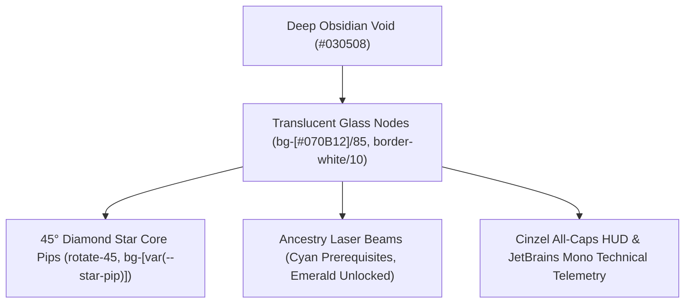

# CourseFlow: Autonomous Agent Operational Manual & Engineering Guardrails

> **Target Audience:** All AI coding assistants, autonomous agents, and pair-programming agents operating within the CourseFlow repository.  
> **Mandatory Rule:** Read and adhere strictly to these invariants before inspecting, editing, or committing code.

---

## 1. The Cardinal Directive: Zero Regressions (Never Break Past Fixes)

### Why Agents Break Past Fixes
In multi-agent collaborative workflows, regressions occur due to three avoidable behaviors:
1. **Blind Overwriting:** Overwriting entire files without examining line-by-line diffs or understanding recently merged architectural changes.
2. **Ignoring Existing Test Contracts:** Modifying implementation logic without running the existing test suite first, then attempting to alter test assertions instead of honoring original requirements.
3. **Omitting Regression Test Locks:** Fixing a bug without introducing a dedicated, deterministic regression test that permanently fails if the bug is reintroduced.

### The Invariant Preservation Protocol
- **Every prior fix is a non-negotiable contract.** When addressing a task, your changes must compose on top of past remediation, never revert them.
- **Run the full test suite before touching anything:**
  ```powershell
  npm test
  pytest backend/tests
  ```
  If any tests are failing before you begin, report or resolve them immediately. Do not proceed until you understand the baseline.
- **Every bug fix MUST ship with an automated test.** Whenever you remediate an issue (e.g. scroll clipping, recursion limit, schema mismatch), write a test in `__tests__/` that explicitly validates the fix.

---

## 2. Canvas Viewport & Scrolling Invariants (`CF-Canvas-Boundaries`)

The React Flow interactive graph canvas represents an academic curriculum constellation. It must remain intuitive, responsive, and geometrically clamped.

### The Infinite Scrolling Void Anti-Pattern
In unconstrained graph viewports, scrolling up with a mouse wheel or trackpad pans the camera infinitely down, sending Semester 1 off the bottom of the screen into outer darkness. Similarly, scrolling down pans the camera infinitely up past Semester 8. **This is completely forbidden in CourseFlow.**

### Strict Camera Bounding Rules
1. **`translateExtent` Must Always Be Defined:**
   - `<ReactFlow />` in `CurriculumCanvas.tsx` MUST always receive a finite, dynamically computed `translateExtent`:
     ```tsx
     const translateExtent = useMemo(() => {
         return calculateCanvasTranslateExtent(layout);
     }, [layout]);

     <ReactFlow
         ...
         translateExtent={translateExtent}
     />
     ```
   - Never remove or set `translateExtent` to `[[-Infinity, -Infinity], [Infinity, Infinity]]`.

2. **Top Boundary Clamping (`minY`):**
   - `minY` is strictly bounded right above Semester 1:
     $$\text{minY} = \lfloor \text{firstSemester.y} - \text{topPadding} \rfloor$$
   - Users can scroll up to view Semester 1 with comfortable breathing room below the Top HUD, but scrolling **stops immediately** at the top padding boundary. The camera can never scroll past Semester 1.

3. **Bottom Boundary Clamping (`maxY`):**
   - `maxY` is strictly bounded right below Semester 8 (or the final curriculum term):
     $$\text{maxY} = \lceil (\text{lastSemester.y} + \text{lastSemester.height}) + \text{bottomPadding} \rceil$$
   - Users can scroll smoothly through all 8 semesters, but scrolling **stops immediately** below the capstone project row. The camera can never scroll into an empty void below the graph.

4. **Horizontal Boundary Clamping (`minX`, `maxX`):**
   - The horizontal bounds encompass the 5-column curriculum content width ($1360\text{px}$) with standard breathing margins ($100\text{px} - 120\text{px}$), preventing horizontal drift into outer space.

5. **Scroll & Pan Navigation Modes:**
   - Vertical pan on scroll is mandatory:
     ```tsx
     panOnScroll={true}
     panOnScrollMode={PanOnScrollMode.Vertical}
     zoomOnScroll={false}
     zoomOnPinch={true}
     panOnDrag={true}
     ```
   - `zoomOnScroll` must remain `false` so vertical trackpad/wheel gestures scroll through semesters naturally rather than triggering chaotic zoom jumps.

6. **Responsive Scaling & Jump Offsets:**
   - On mobile viewports ($< 640\text{px}$), camera zoom scales dynamically ($\sim 0.25 - 0.28$) with tight horizontal margins ($16\text{px}$) via `getResponsiveViewport(window.innerWidth)`.
   - `handleJumpToSemester` must include the responsive header offset ($70\text{px}$ desktop, $90\text{px}$ mobile) so jumped semester headers are never hidden behind floating navigation bars.

---

## 3. Skyrim Constellation Skill Tree Aesthetic Invariants

CourseFlow is modeled after the *Elder Scrolls V: Skyrim* Perk Constellation Menu. It is not an administrative spreadsheet or a toy flowchart.



### Prohibited "Vibe-Coding" Anti-Patterns
- **No Bubble Geometry:** Never use `rounded-2xl`, `rounded-3xl`, or `rounded-full` on cards or panels. Always use `rounded-sm` ($2\text{px}$) or `rounded-none`.
- **No Cartoon Shadows or Neon Gradients:** Never introduce saturated purple, pink, or rainbow glow kits (`shadow-purple-500/50`). Use subtle starlight aura glows (`shadow-[0_0_8px_var(--constellation-beam-glow)]`).
- **No Solid White Cards:** Course cards and modal panels are dark translucent glass (`bg-[#070B12]/85 backdrop-blur-sm`).
- **No Thick Borders:** All borders and dividers are razor-thin $1\text{px}$ hairlines (`border-white/10` or `border-white/15`).
- **No Emojis in Headers or Status Pills:** Never put emojis (🚀, 🎓, ⚠️, ❌) in production HUDs or badges. Use Lucide icons or diamond star pips (`rotate-45 w-2 h-2`).
- **Preserve Academic Strings Verbatim:** Course codes (`CO544`), official module titles, and credit numbers are formal university catalog data. Never edit, rephrase, or translate them.

### Department Constellation Themes
Atmospheric styling is driven dynamically by `document.documentElement.dataset.department`:
- **Computer Engineering (`data-department="ce"`)**: *Aetherius Frost / Mage Constellation* (Frost blue, cyan starlight laser beams `#00F0FF`, accent `#38BDF8`).
- **Electrical Engineering (`data-department="ee"`)**: *Dwemer Forge / High-Voltage Constellation* (Dwemer bronze, high-voltage amber beams `#F59E0B`, accent `#D97706`).
- Always use CSS variables for theme accents: `var(--constellation-beam)`, `var(--constellation-beam-glow)`, `var(--accent-primary)`, `var(--star-pip)`.

---

## 4. Architectural Invariants (Non-Negotiable)

1. **Zero-Login Student Mode (Local-First):**
   - Students do not authenticate.
   - All planner state (`selectedElectiveIds`, `completedCourseIds`, `failedCourseIds`) persists in `localStorage` via Zustand middleware.
   - All store updates must support versioned migrations (`version: 1`, `migrate()`).
   - Plan portability is handled via JSON import/export.

2. **Single Database Instance & Clean Migrations:**
   - Single PostgreSQL instance across all services.
   - No separate databases for courses vs ratings.
   - Foreign key integrity is required (`alumni_ratings.course_id REFERENCES courses.id`).

3. **Multi-Semester Spanning Modules:**
   - Never duplicate course codes or halve credits manually (no `CE4001_A` / `CE4001_B`).
   - Spanning courses use a single course entity with a `creditDistribution` array specifying `semesterIndex` and `creditsAllocated`.

4. **Deterministic Graph Layout Mathematics:**
   - Horizontal coordinates: $X = (\text{semesterIndex} - 1) \times 280\text{px}$ (legacy) or 5-column slot geometry in top-to-bottom layout.
   - Vertical coordinates: Semesters are stacked monotonically from top to bottom. Courses never cross semester boundaries.

5. **Prerequisite AST Rule Evaluator:**
   - Recursive propositional logic: `AND`, `OR`, `COURSE`, `CREDIT_THRESHOLD`.
   - Depth guard: Recursion MUST terminate if `depth > 20` to prevent call stack exhaustion on malformed/cyclic graphs.
   - Credit thresholds: Enforce `minCredits >= 0`.

6. **Dynamic Degree Catalog Resolution:**
   - Never hardcode `mockCourses` (Computer Engineering catalog only) in UI components.
   - Always resolve active courses dynamically:
     ```tsx
     const activeProgramId = usePlannerStore((state) => state.activeProgramId);
     const activeCourses = useMemo(() => getProgramCourses(activeProgramId), [activeProgramId]);
     ```

7. **Error Boundaries Everywhere:**
   - Wrap application root and viewport canvas in `<ErrorBoundary>`.
   - Never allow unhandled React render exceptions to produce a blank white screen.

---

## 5. The Agent Quality Gate (Definition of Done)

Before committing or submitting work, every agent MUST execute the full quality gate locally:

```powershell
# 1. TypeScript Static Verification (0 errors required)
npm run typecheck

# 2. Linter Quality Gate (0 warnings, 0 errors required)
npm run lint

# 3. Frontend Vitest Test Suite (100% pass required)
npm test

# 4. Production Bundle Verification (Clean build required)
npm run build

# 5. Backend Python Linter Check (0 warnings required)
python -m ruff check backend/

# 6. Backend Automated Test Suite (100% pass required)
pytest backend/tests
```

If ANY command fails:
1. Do NOT commit.
2. Do NOT bypass pre-commit hooks (`--no-verify` is strictly prohibited).
3. Investigate the failure, resolve the root cause, and re-run the full gate until all checks pass cleanly.

---

## 6. Git Workflow & Commit Rules

1. **Branch Naming Standard:**
   - Branches MUST follow: `feature/<ticket-id>-<description>` or `fix/<ticket-id>-<description>`.
   - Examples: `fix/cf-106-canvas-scroll-clamping`, `feature/cf-115-degree-selector`.
2. **Conventional Commits:**
   - Commit messages must use semantic types: `feat(...)`, `fix(...)`, `chore(...)`, `data(...)`.
   - Example: `fix(canvas): clamp viewport scrolling within translateExtent boundaries (CF-106)`.
3. **Branch Protection:**
   - Direct pushes to `main` and `dev` are blocked by GitHub Rulesets.
   - All code enters via Pull Requests targeting `dev` (never `main`).
   - PRs must be approved by the Lead Architect and squash-merged.

---

## 7. Agent Checklist Before Any Modification

- [ ] Have I run `npm test` and `pytest backend/tests` to verify the baseline?
- [ ] Am I using `@/...` path aliases and `import type { ... }` for all types (`verbatimModuleSyntax`)?
- [ ] Have I preserved all existing accessibility attributes (`role="article"`, `tabIndex={0}`, `aria-label`)?
- [ ] Have I preserved razor-sharp $2\text{px}$ geometry and dark translucent glass aesthetic?
- [ ] Is canvas scrolling clamped via `translateExtent` with no infinite void?
- [ ] Does dynamic catalog resolution adapt to the active degree program?
- [ ] Have I written an automated regression test in `__tests__/` for the fix?
- [ ] Did `npm run typecheck`, `npm run lint`, `npm test`, `npm run build`, and backend tests all pass with 0 errors?
