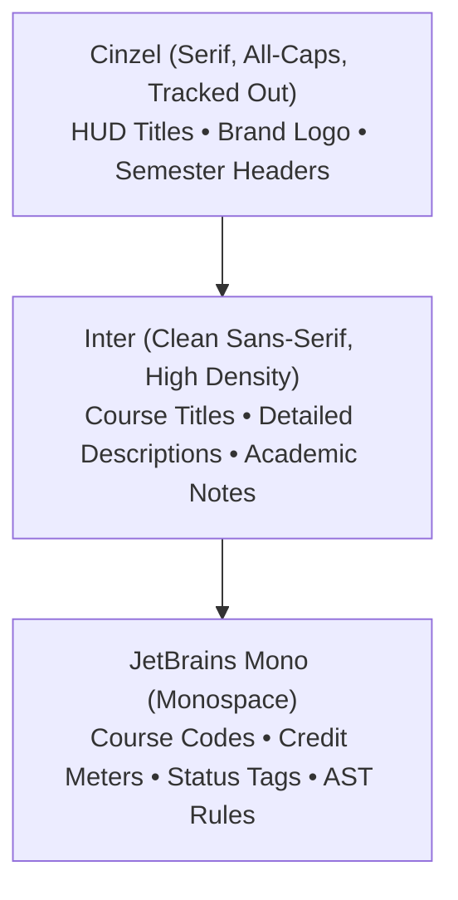

# CourseFlow: Frontend Design Philosophy & Visual Architecture

> **Aesthetic Archetype:** Authentic Skyrim Skill Tree (*The Elder Scrolls V: Skyrim* Perk Constellation Menu).  
> **Visual Spirit:** Austere, dark celestial star-chart with razor-sharp geometry, fine hairline borders, and deep atmospheric lighting.

---

## 1. Core Vision & Design Anti-Patterns

### What CourseFlow Looks and Feels Like
CourseFlow visualizes university engineering curricula not as administrative spreadsheets or toy flowchart widgets, but as a **living celestial star chart**. Every course module is an anchored star pip in an academic constellation; prerequisite dependencies are starlight laser beams cast across celestial coordinates; and the student's progress is tracked along a metallic skill bar reminiscent of Skyrim's Level and Perk progression HUD.

### Elimination of Generic "Vibe-Coding"
Modern web design frequently defaults to generic SaaS kits characterized by overly rounded pastel cards, saturated neon purple gradients, cartoon drop-shadows, and emojis. **CourseFlow strictly forbids this approach.**

| Prohibited Anti-Pattern | Required Celestial Aesthetic |
| :--- | :--- |
| Overly rounded bubble cards (`rounded-2xl`, `rounded-3xl`) | Razor-sharp geometry with 2px corner radius (`rounded-sm` or `rounded-none`). |
| Heavy saturated neon drop shadows (`shadow-purple-500/50`) | Subtle starlight aura glows (`shadow-[0_0_8px_var(--constellation-beam-glow)]`). |
| Solid bright cartoon fills and white cards | Dark translucent glass surface (`bg-[#070B12]/85 backdrop-blur-sm`). |
| Thick colorful borders and playful iconography | Razor-thin 1px hairline metallic borders (`border-white/10`). |
| Emojis in HUD headers and status pills (🚀, 🎓, ⚠️) | Minimalist diamond star pips and technical monospace status tags. |
| Altering or translating academic strings | Preserving all course codes, titles, and credit labels **verbatim**. |

---

## 2. Dynamic Theme Engine & Department Constellations

CourseFlow adapts its celestial atmospheric mood depending on the active engineering department. This is powered by Tailwind CSS v4 `@theme` tokens and CSS custom properties toggled dynamically on `document.documentElement.dataset.department`:

```css
@theme {
  --color-skyrim-void: #030508;
  --color-glass-surface: rgba(10, 15, 24, 0.75);
  --color-glass-surface-hover: rgba(16, 24, 38, 0.85);
  --color-border-hairline: rgba(255, 255, 255, 0.08);
  --color-border-active: rgba(255, 255, 255, 0.25);
  
  --color-star-white: #F8FAFC;
  --color-star-dim: #475569;
  --color-star-completed: #F59E0B;

  --font-serif: 'Cinzel', serif;
  --font-sans: 'Inter', sans-serif;
  --font-mono: 'JetBrains Mono', monospace;
}

/* Computer Engineering: Aetherius Frost / Mage Constellation */
:root, [data-department="ce"] {
  --nebula-core: radial-gradient(circle at 50% 30%, rgba(2, 132, 199, 0.14) 0%, rgba(3, 5, 8, 0.98) 75%);
  --constellation-beam: #00F0FF;
  --constellation-beam-glow: rgba(0, 240, 255, 0.35);
  --accent-primary: #38BDF8;
  --node-border-highlight: rgba(56, 189, 248, 0.5);
  --star-pip: #E0F2FE;
}

/* Electrical Engineering: Dwemer Forge / High-Voltage Constellation */
[data-department="ee"] {
  --nebula-core: radial-gradient(circle at 50% 30%, rgba(217, 119, 6, 0.12) 0%, rgba(5, 4, 3, 0.98) 75%);
  --constellation-beam: #F59E0B;
  --constellation-beam-glow: rgba(245, 158, 11, 0.35);
  --accent-primary: #D97706;
  --node-border-highlight: rgba(245, 158, 11, 0.5);
  --star-pip: #FEF3C7;
}
```

### Department Atmospheric Profiles:
1. **Computer Engineering (`data-department="ce"`)**: Inspired by Skyrim's *Mage* guardian stone and the icy depths of Aetherius. Cool frost-blue and cyan rays illuminate computational pipelines and software architectures.
2. **Electrical and Information Engineering (`data-department="ee"`)**: Inspired by Skyrim's *Dwemer Forge* and high-voltage kinetic energy. Deep bronze and amber beams illuminate circuit networks and electromagnetic modules.

---

## 3. Typography Architecture

The typographic hierarchy balances classical mythic grandeur with technical precision:



- **Cinzel (`font-serif`, 400/600/700)**: Used exclusively for solemn headings, the `CourseFlow` brand title, and Roman numeral swimlane markers. Always uppercase with generous tracking (`tracking-[0.2em]` or `tracking-[0.15em]`).
- **Inter (`font-sans`, 400/500/600)**: Used for body text, course module titles, and drawer descriptions to ensure readability at compact sizes.
- **JetBrains Mono (`font-mono`, 400/500/600)**: Used for technical artifacts: course codes (`CO1002`), credit counters (`120 / 150 Credits`), prerequisite propositional expressions, and workload meters.

---

## 4. Component Implementations & Responsive Ergonomics

### A. Top Navigation Bar (`TopNav.tsx` & `DegreeSelector.tsx`)
- **HUD Glass Surface**: `backdrop-blur-md bg-[#030508]/85 border-b border-white/10`.
- **Logomark**: `CourseFlow` in all-caps 'Cinzel', tracked out with a centered 45° diamond star pip.
- **Department Selector**: Minimalist, flush translucent pill (`bg-white/5 border border-white/10 text-xs font-mono uppercase tracking-widest text-slate-200`). Toggling departments updates the root DOM attribute `data-department` instantly. Text truncates gracefully on mobile screens (`max-w-[130px] sm:max-w-[200px]`).
- **Graduation Credit Bar (Skyrim Skill Progression Bar)**:
  - Thin 3px horizontal track with 1px metallic end-caps.
  - Active fill colored with `var(--constellation-beam)` and atmospheric beam glow.
  - Sliding diamond pip indicator at current progress point.
  - Monospace readout: `120 / 150 Credits`.
- **Export PDF Action**: Flat rectangular plate with hairline border (`rounded-none border border-white/15 bg-white/5 hover:bg-white/10 text-xs font-mono uppercase tracking-widest`).

### B. Semester Swimlanes (`SwimlaneHeader.tsx`)
- **Celestial Horizon Equator**: Hairline metallic dividers replace heavy boxed headers.
- **Roman Numeral Watermark**: A faint classical watermark (`I`, `II`, `III`, etc.) anchored at the far left at `opacity-[0.04]` behind each semester lane.
- **Lane Title**: All-caps Cinzel serif (`Semester 1`, `Semester 2`), accompanied by an etched module count plate (`[8 courses]`).
- **Real-Time Workload Horizon**: A 3px progress track with threshold markers at 18 credits (minimum target) and 24 credits (maximum recommended), signaling load compliance with crisp status tags (`18 cr • Valid Load` in clean emerald, or underload alerts).

### C. Course Card Nodes (`CourseNode.tsx`)
- **Geometry**: Fixed 240px width, crisp 2px corner radius (`rounded-sm`), dark translucent glass finish (`bg-[#070B12]/85 backdrop-blur-sm`).
- **Star Core Node Pip**: Diamond-shaped star node centered directly on the top React Flow handle (`w-2.5 h-2.5 rotate-45 border border-white/40 bg-[var(--star-pip)]`).
- **Card Header**: High-contrast silver monospace code (`text-slate-100 font-mono text-xs font-semibold`), compact rectangular plate badge (`CORE`, `ELECTIVE`, `CAPSTONE`), and accent credit count (`3 cr`).
- **State Handling**:
  - *Completed*: Diamond star core flares in radiant amber/gold; subtle silver checkmark.
  - *Active / Enrolled*: Hairline border glows with active department beam color (`var(--constellation-beam)`).
  - *Missing Prereqs*: Smoked background opacity (`0.6`) with an etched red alert border and diagnostic feedback.
  - *Elective Selected*: Emerald hairline border and glowing star indicator.

### D. Constellation Starlight Beams (`CurriculumCanvas.tsx` & `graphHighlight.ts`)
- **Routing**: Smooth orthogonal step routing across semester bands.
- **Dormant State**: Faint, cold starlight rays (`stroke: rgba(255, 255, 255, 0.15)`, `strokeWidth: 1.25px`, `opacity: 0.65`).
- **Ancestry Illumination (Hover & Selection)**:
  - *Upstream Prerequisites*: Concentrated starlight laser beam (`stroke: #00F0FF` / `#06b6d4`, `strokeWidth: 1.75px` with dashed travel animation).
  - *Downstream Dependents*: Unlocked path illuminated in vibrant emerald (`stroke: #10B981`, `strokeWidth: 1.75px`).
  - *Unconnected Constellations*: Drop into the background void at `opacity: 0.08`.

### E. Canvas Controls & Radar Minimap
- **Minimap (Celestial Armillary Radar)**: Minimalist celestial radar (`bg-[#030508]/90 border border-white/10 rounded-sm`) rendering nodes as diamond star pips. Automatically hidden on mobile viewports (`< 768px`) with an optional diamond radar toggle button to keep mobile screens uncluttered.
- **Controls Stack**: Translucent floating glass stack (`+`, `-`, `Fit View`) with 1px hairline dividers and square buttons.
- **Starfield Background**: Celestial dot starfield (`BackgroundVariant.Dots`, 24px gap, size 1, `rgba(255, 255, 255, 0.08)`).

### F. Responsive Viewport Scaling & Screen Size Ergonomics
- **Dynamic Viewport Auto-Fitting**: `getResponsiveViewport` evaluates the actual viewport width `window.innerWidth`. On mobile phones (`360px - 480px`), it calculates the exact zoom factor (`~0.25 - 0.28`) and centers the graph horizontally with 16px margins, preventing the graph from rendering 3x too large.
- **Live Resize & Orientation Listener**: A window resize listener automatically recalculates the zoom and horizontal centering whenever the user resizes their desktop browser or rotates their mobile phone.
- **Pinch-to-Zoom & Touch Navigation**: Enabled `zoomOnPinch={true}` and `panOnDrag={true}` with an expanded zoom scale (`minZoom: 0.12`, `maxZoom: 2.5`), allowing users on mobile to pinch-zoom seamlessly between the whole constellation overview and extreme close-ups of individual module cards.
- **Fit Width Shortcut**: Added a dedicated `Fit Width` shortcut pill in the semester jump bar to immediately reset the canvas to the optimal width on any screen.
- **Mobile Semester Jump Offsets**: Jump pill navigation accounts for mobile HUD offsets so jumped semester headers never get occluded behind floating headers.

---

## 5. Rules for Future Contributors

1. **Never alter academic strings**: All course codes, titles, and credit labels are official academic records. Render them verbatim without renaming or editorial adjustments.
2. **Preserve razor-sharp geometry**: Use `rounded-sm` (2px) or `rounded-none`. Never introduce `rounded-2xl` or `rounded-full` cards.
3. **Keep borders hairline thin**: All structural dividers and card edges should use 1px borders with low-opacity white (`border-white/10` or `border-white/15`).
4. **Adhere to the dynamic department tokens**: Always style constellation accents using `var(--constellation-beam)`, `var(--constellation-beam-glow)`, `var(--accent-primary)`, and `var(--star-pip)`.
5. **Always verify before merging**:
   ```bash
   # From within frontend/
   npx oxlint --deny-warnings src
   npm run typecheck
   npm test
   npm run build
   ```
