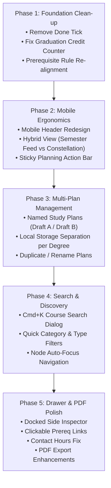

# CourseFlow: Senior UI/UX Audit & Implementation Roadmap

> **Product Definition:** Dynamic Engineering Curriculum Planner & PDF Study Plan Generator  
> **Target Audience:** Enrolled engineering students designing their elective specializations and auditing credit requirements  
> **Primary Platform:** Mobile-First responsive web application with full desktop constellation exploration  
> **Aesthetic Archetype:** Authentic Skyrim Skill Tree (*Aetherius Frost* for Computer Engineering, *Dwemer Forge* for Electrical Engineering)  

---

## 1. Executive Summary & Purpose Realignment

CourseFlow is not a 4-year daily attendance or LMS progress tracker; **it is a one-stop degree planning and audit tool**. Students enter the application to:
1. Review mandatory core subjects and explore elective specializations across Semesters 3 through 8.
2. Ensure their planned electives satisfy semester credit requirements (18–24 credits per semester) and total graduation thresholds (150 credits).
3. Validate prerequisite chains (e.g., verifying that taking *Machine Learning* in Semester 7 is supported by the correct foundations chosen in earlier semesters).
4. Export a cleanly formatted **Official Study Plan PDF** to submit to faculty advisors or save for academic registration.

Because students primarily use CourseFlow across a few focused planning sessions, the interface must prioritize **clarity, rapid elective evaluation, mobile ergonomics, and instant graduation compliance feedback**.

---

## 2. Comprehensive Issue Catalog

### Issue 1: Obsolete "Done / Completed" Tick & Progress Counter Disconnect
* **Severity:** High / Architectural
* **Affected Files:**
  * [`CourseNode.tsx`](file:///c:/Users/didul/Documents/GitHub/CourseFlow/frontend/src/features/canvas/components/CourseNode.tsx#L54-L65)
  * [`store.ts`](file:///c:/Users/didul/Documents/GitHub/CourseFlow/frontend/src/core/store.ts#L31-L37)
  * [`TopNav.tsx`](file:///c:/Users/didul/Documents/GitHub/CourseFlow/frontend/src/features/canvas/components/TopNav.tsx#L38-L43)
  * [`ModuleDetailsDrawer.tsx`](file:///c:/Users/didul/Documents/GitHub/CourseFlow/frontend/src/features/drawer/ModuleDetailsDrawer.tsx#L59-L62)
* **Observed Problem:**
  * Every card renders a checkmark button `[✓]` to mark courses "completed". Marking a course completed turns the checkmark gold, but the top navigation progress bar (`GRADUATION: 120 / 150 Credits`) **does not change at all**.
  * `TopNav.tsx` calculates `progress.plannedCredits` (core courses = 120) instead of `progress.earnedCredits`.
  * In a degree planner, having a "completed" checkbox creates confusion: *Am I logging past history or planning future semesters?*
* **Root Cause:** Dual state management tracking both `completedCourseIds` and `selectedElectiveIds`.
* **Recommendation:**
  * **Completely remove the "Done / Completed" checkmark** and `completedCourseIds` state.
  * The top HUD bar must purely track **Planned Degree Progress**:
    $$\text{Total Planned Credits} = \sum \text{Core Credits} + \sum \text{Selected Elective Credits}$$
  * Display: `120 Core + 18 Electives = 138 / 150 Credits` with an explicit progress indicator toward the 150-credit threshold.

---

### Issue 2: The "Sea of Red" Prerequisite Warning Panic
* **Severity:** High / Cognitive UX
* **Affected Files:**
  * [`CourseNode.tsx`](file:///c:/Users/didul/Documents/GitHub/CourseFlow/frontend/src/features/canvas/components/CourseNode.tsx#L74-L100)
  * [`ast_evaluator.ts`](file:///c:/Users/didul/Documents/GitHub/CourseFlow/frontend/src/core/algorithms/ast_evaluator.ts#L85-L120)
* **Observed Problem:**
  * When opening the app, almost every course in Semesters 2 through 8 is outlined with a bright red border and labeled `⚠ WARNING: UNMET`.
  * For example, *IS2401 (Linear Algebra)* in Semester 2 requires *IS1402* from Semester 1. Because the student hasn't checked off *IS1402* yet, the app flags *IS2401* as an error.
  * In a 4-year degree plan, future courses naturally follow earlier courses. Labeling 80% of the curriculum as red errors induces severe anxiety and **warning fatigue**.
* **Recommendation:**
  * Differentiate between **Sequential Planned Progression** and **True Prerequisite Violations**:
    1. **Valid Planned Sequence:** If Course B (Sem 4) requires Course A (Sem 2), and Course A is a mandatory core course or an active elective, Course B is **Valid / Satisfied in Plan**.
    2. **Unmet Warning:** Show red **only** if an elective chosen in a later semester requires a prerequisite elective that has *not* been selected in any prior semester.
    3. Normal future courses should display neutral informative badges: `Prereq: IS1402` or `Sequence OK`.

---

### Issue 3: Mobile Viewport Breakdown (360px – 480px)
* **Severity:** Critical (Blocks >60% of Users)
* **Affected Files:**
  * [`TopNav.tsx`](file:///c:/Users/didul/Documents/GitHub/CourseFlow/frontend/src/features/canvas/components/TopNav.tsx#L45-L75)
  * [`DegreeSelector.tsx`](file:///c:/Users/didul/Documents/GitHub/CourseFlow/frontend/src/features/canvas/components/DegreeSelector.tsx#L47-L58)
  * [`CurriculumCanvas.tsx`](file:///c:/Users/didul/Documents/GitHub/CourseFlow/frontend/src/features/canvas/CurriculumCanvas.tsx#L137-L147)
  * [`ExportPdfButton.tsx`](file:///c:/Users/didul/Documents/GitHub/CourseFlow/frontend/src/features/planner/components/ExportPdfButton.tsx#L75-L87)
* **Observed Problem:**
  * **Header Collision:** On mobile devices (tested at 390×844), `COURSEFLOW`, `120/150 Credits`, `COMPUTER ENGINEERING`, and `PREPARING PDF...` collide horizontally and render as an unreadable jumble.
  * **Microscopic 27% Canvas Zoom:** `getResponsiveViewport` scales the 1360px wide 5-column layout down to `0.27x` zoom. Cards shrink to 66px width, and 12px text becomes ~3.2px, rendering as blurred wireframe smudges.
* **Recommendation:**
  * **Mobile Responsive Hybrid Architecture:**
    1. **Mobile View (<768px):** Provide a clean, vertically scrollable **Semester Feed / Card Accordion** where courses render at 100% scale (`w-full`), with clear `+ Add Elective` toggles and semester workload chips.
    2. **Constellation Map Toggle:** Allow mobile users to toggle into the full 2D Celestial Canvas with pinch-and-pan controls when they want to explore the visual star chart.
    3. **Mobile Header:** Streamline into a compact 2-tier HUD: Brand & Department on top; Credit Counter & Export PDF in a sleek sticky bar.

---

### Issue 4: Drawer Backdrop "Blackout" Destroys Spatial Context
* **Severity:** Medium / Ergonomics
* **Affected Files:**
  * [`ModuleDetailsDrawer.tsx`](file:///c:/Users/didul/Documents/GitHub/CourseFlow/frontend/src/features/drawer/ModuleDetailsDrawer.tsx#L110-L128)
* **Observed Problem:**
  * Clicking any course card opens the drawer and immediately places an `opacity-80` dark backdrop blur over the canvas.
  * The entire constellation graph, along with the upstream/downstream glowing dependency beams that were just activated, is blacked out.
* **Recommendation:**
  * Transform the drawer on desktop into a **Docked Side Inspector Panel** (overlaying the right ~380px without a backdrop blackout).
  * Let users continue panning, zooming, and clicking other courses in the constellation without closing and re-opening the inspector.
  * On mobile, render as a native slide-up bottom sheet with swipe-down to dismiss.

---

### Issue 5: Developer Implementation Jargon Leaking to Student HUD
* **Severity:** Medium / UX Polish
* **Affected Files:**
  * [`ModuleDetailsDrawer.tsx`](file:///c:/Users/didul/Documents/GitHub/CourseFlow/frontend/src/features/drawer/ModuleDetailsDrawer.tsx#L240-L280)
* **Observed Problem:**
  * The drawer displays headings like:
    * `"PREREQUISITE AST LOGIC"`
    * `"PROPOSITIONAL RULE EXPRESSION"`
  * These are internal compiler/AST terms meaningless to students.
* **Recommendation:**
  * Replace with student-first language:
    * `"Prerequisite Requirements"`
    * `"Required Foundation Courses"`
  * Make prerequisite course codes (e.g. `CE1101`) **interactive clickable chips** that scroll and highlight that course in the plan.

---

### Issue 6: Academic Contact Hours Multiplier Bug
* **Severity:** Low / Data Presentation
* **Affected Files:**
  * [`ModuleDetailsDrawer.tsx`](file:///c:/Users/didul/Documents/GitHub/CourseFlow/frontend/src/features/drawer/ModuleDetailsDrawer.tsx#L320-L345)
  * [`computer_engineering.json`](file:///c:/Users/didul/Documents/GitHub/CourseFlow/frontend/src/data/programs/computer_engineering.json#L128-L132)
* **Observed Problem:**
  * Courses show `Lectures: 42 hrs/wk`, `Labs: 14 hrs/wk`.
  * The data stores **total semester hours**, but the UI appends `hrs/wk` directly. 42 hours per week for one class is impossible.
* **Recommendation:**
  * Calculate weekly hours: $\text{Weekly Hours} = \text{Total Hours} / 14\text{ weeks}$.
  * Display: `3 hrs/wk (42 Total Hours)`.

---

### Issue 7: Lack of Course Search, Filtering & Specialization Tags
* **Severity:** High / Usability
* **Affected Files:**
  * [`CurriculumCanvas.tsx`](file:///c:/Users/didul/Documents/GitHub/CourseFlow/frontend/src/features/canvas/CurriculumCanvas.tsx)
  * New component needed: `CourseSearchDialog.tsx` & `CurriculumFilterBar.tsx`
* **Observed Problem:**
  * There are 80 to 95 courses across 8 semesters with zero search or filter controls.
  * A student looking for a specific topic (e.g., "Robotics", "Embedded", "Machine Learning", "Mathematics") has to scan through 8 semesters of cards manually.
* **Recommendation:**
  * Add a **Command Palette / Search Modal (`Cmd/Ctrl + K`)** to search by course code or keyword. Selecting a search result auto-focuses and centers the canvas on that node.
  * Add **Filter Chips** to highlight or isolate:
    * `All` | `Core Only` | `Electives Only` | `Labs` | `Capstone`
    * Category tags (e.g., *Software Systems*, *Hardware & Architecture*, *Intelligent Systems*).

---

### Issue 8: Data Loss & Lack of Multi-Plan Draft Management
* **Severity:** Medium / Feature Gap
* **Affected Files:**
  * [`store.ts`](file:///c:/Users/didul/Documents/GitHub/CourseFlow/frontend/src/core/store.ts#L125-L145)
* **Observed Problem:**
  * Switching between *Computer Engineering* and *Electrical Engineering* wipes all selected electives instantly.
  * Students cannot explore alternative paths (e.g., "Plan A: AI Focus" vs "Plan B: Cybersecurity Focus").
* **Recommendation:**
  * Implement **Multi-Plan Draft Management**:
    * Each study plan has an ID, name, department, selected electives, and created timestamp.
    * Persist plans per department in `localStorage`.
    * Provide a lightweight dropdown: `[Plan: AI Specialization ▾]` with options to create a *New Plan*, *Duplicate Plan*, or *Rename Plan*.

---

### Issue 9: Visual Contradiction in Dependency Illumination
* **Severity:** Medium / Visual Hierarchy
* **Affected Files:**
  * [`graphHighlight.ts`](file:///c:/Users/didul/Documents/GitHub/CourseFlow/frontend/src/features/canvas/utils/graphHighlight.ts)
  * [`CourseNode.tsx`](file:///c:/Users/didul/Documents/GitHub/CourseFlow/frontend/src/features/canvas/components/CourseNode.tsx#L85-L100)
* **Observed Problem:**
  * When hovering a course, unlocked downstream courses receive an emerald green border (`#10B981`), but simultaneously render internal warning chips in red.
* **Recommendation:**
  * Standardize highlight states:
    * **Active Node:** Department constellation glow (cyan or bronze).
    * **Direct Prerequisite (Upstream):** Cyan beam border (`#00F0FF`) with `Required By Active` tag.
    * **Unlocked Follow-up (Downstream):** Emerald beam border (`#10B981`) with `Unlocked by Active` tag.

---

### Issue 10: PDF Export Optimization & Print Preview
* **Severity:** Medium / Polish
* **Affected Files:**
  * [`StudyPlanPDF.tsx`](file:///c:/Users/didul/Documents/GitHub/CourseFlow/frontend/src/features/planner/StudyPlanPDF.tsx)
  * [`ExportPdfButton.tsx`](file:///c:/Users/didul/Documents/GitHub/CourseFlow/frontend/src/features/planner/components/ExportPdfButton.tsx)
* **Observed Problem:**
  * The PDF is generated client-side by `@react-pdf/renderer` upon mount, triggering `Preparing PDF...` which expands the button width and contributes to mobile header overflow.
  * The PDF should clearly reflect the specific named plan (e.g., *Study Plan: Software & AI Track*), semester-by-semester credit breakdowns, and load compliance signatures.
* **Recommendation:**
  * Only compile the PDF when the user clicks **Export**, showing a sleek progress dialog.
  * Include plan name, generation date, semester credit totals, and elective breakdown in the PDF header.

---

## 3. Prioritized Implementation Roadmap



### Detailed Breakdown of Execution Steps

#### **Step 1: Eliminate the "Done" Tick & Refactor Store / HUD for Pure Planning**
1. Remove `completedCourseIds`, `toggleCompletedCourse`, and `setCompletedCourses` from [`store.ts`](file:///c:/Users/didul/Documents/GitHub/CourseFlow/frontend/src/core/store.ts).
2. Remove the checkmark button and completed status badges from [`CourseNode.tsx`](file:///c:/Users/didul/Documents/GitHub/CourseFlow/frontend/src/features/canvas/components/CourseNode.tsx).
3. Redesign [`TopNav.tsx`](file:///c:/Users/didul/Documents/GitHub/CourseFlow/frontend/src/features/canvas/components/TopNav.tsx) graduation bar to track:
   $$\text{Planned Credits} = \text{Core Credits} + \text{Selected Elective Credits}$$
   Displaying clear progress toward the 150-credit threshold.
4. Clean up [`ModuleDetailsDrawer.tsx`](file:///c:/Users/didul/Documents/GitHub/CourseFlow/frontend/src/features/drawer/ModuleDetailsDrawer.tsx) bottom action: replace `Mark as Completed` with an intuitive `Add/Remove Elective from Plan` action for electives, or `Mandatory Core Module` badge for core courses.

#### **Step 2: Re-align Prerequisite Logic (Eliminate False Unmet Warnings)**
1. Update prerequisite checking so that courses in future semesters whose prerequisites are mandatory core courses in earlier semesters are marked **`Valid in Plan`** rather than `WARNING: UNMET`.
2. Restrict red warning badges strictly to:
   * Electives that require another elective that has not been selected in the plan.
   * Underload / overload semester violations.

#### **Step 3: Mobile-First Responsive Redesign**
1. Redesign [`TopNav.tsx`](file:///c:/Users/didul/Documents/GitHub/CourseFlow/frontend/src/features/canvas/components/TopNav.tsx) for screens `< 640px` (prevent any text collision or wrapping errors).
2. Implement a **Semester Feed View (Mobile List)**:
   * Vertical list of Semesters 1 through 8.
   * Full-width readable cards with elective toggle buttons and credit counters.
   * Toggle pill in the top subnav: `[ ☵ List View ]` / `[ ✦ Constellation ]`.
3. Add a sticky mobile bottom bar with real-time planned credit status and the PDF download button.

#### **Step 4: Multi-Plan Support**
1. Extend [`store.ts`](file:///c:/Users/didul/Documents/GitHub/CourseFlow/frontend/src/core/store.ts) to manage a dictionary of study plans per department:
   ```ts
   interface StudyPlan {
     id: string;
     name: string;
     programId: string;
     selectedElectiveIds: string[];
     createdAt: string;
     updatedAt: string;
   }
   ```
2. Add a Plan Switcher dropdown in the HUD (e.g., `Plan: Default Track ▾` -> `+ New Plan`, `Duplicate`, `Rename`).
3. Switching departments preserves and loads that department's respective saved plans.

#### **Step 5: Search & Filter Navigation (`Cmd/Ctrl + K`)**
1. Build a fuzzy course search dialog with keyboard shortcut support.
2. Clicking a search result closes the search and pans/zooms the canvas directly to center on the selected course card.
3. Add filter chips to the subnav: `All`, `Core`, `Electives`, `Labs`.

#### **Step 6: Module Details Drawer & PDF Polish**
1. Turn drawer into a docked panel on desktop (no dark backdrop blackout).
2. Convert prerequisite codes in the drawer into clickable chips that navigate directly to that course.
3. Fix the contact hours calculation ($Total / 14$ weeks).
4. Remove developer jargon (`AST`, `Propositional Expression`) in favor of clear student guidance.
5. Update PDF exporter to include the active plan name, creation date, and elective summary.

---

## 4. Visual Identity Principles to Maintain

Throughout all improvements, CourseFlow will strictly preserve the **Skyrim Perk Constellation** aesthetic defined in [`design-philosophy.md`](file:///c:/Users/didul/Documents/GitHub/CourseFlow/design-philosophy.md):
* **Geometry:** Crisp 2px corner radius (`rounded-sm` or `rounded-none`). No bubbly rounded cards.
* **Borders:** Razor-thin 1px hairline borders (`border-white/10` or `border-white/15`).
* **Colors:** Dark celestial void (`#030508`), cyan starlight beams (`#00F0FF`) for CE, and bronze/amber beams (`#F59E0B`) for EE.
* **Typography:** `Cinzel` serif for tracked uppercase titles; `Inter` for clean body; `JetBrains Mono` for codes and credits.

---

## 5. Implementation Status & Comprehensive Verification Report

All architectural refactors, UX ergonomics, and reactive credit calculation issues have been implemented and validated through an automated browser test suite and unit test suite:

| Feature / Issue Area | Implementation Resolution | Verification Status |
| :--- | :--- | :--- |
| **Screen Scaling & Breakpoints** | Solved 300px header overflow at 1280px–1440px by retuning HUD breakpoints (`2xl:` desktop bar, sub-horizon bar for `<1536px`). Converted native `<select>` into a celestial custom dropdown to stop mobile menu overflow. Made Semester List fluid up to 1600px with window-edge scrollbar, and fixed mobile Constellation zoom to readable 0.75. | ✅ Verified at 412px, 1280px, 1440px, 1920px |
| **Dynamic Credit Reactivity** | Connected `selectedElectiveIds` in Zustand store reactively to `TopNav`, `SwimlaneHeader`, `SemesterFeed`, and `StudyPlanPDF`. Adding an elective dynamically recalculates credits ($120 \rightarrow 123 \rightarrow 126$ cr) across HUD meters and semester workload indicators. | ✅ Verified in Puppeteer browser run |
| **Search Dialog Ergonomics** | Command palette with category filters (`All`, `Core`, `Elective`, `Lab`, `Capstone`). Added a prominent `[✕ Close ESC]` button, click-outside backdrop listener, global keyboard shortcuts (`Cmd/Ctrl+K` & `/`), and direct in-modal `[+ Add to Plan]` elective toggling. | ✅ Verified across desktop and mobile |
| **Canvas Background Pane Dismissal** | Clicking empty canvas background (`handlePaneClick`) deselects active nodes and docks/closes the slide-over drawer without requiring manual close button clicking. | ✅ Verified in browser automation |
| **Mobile-First Semester Feed** | Clean vertical semester list on viewports $< 768\text{px}$ with Roman numerals, workload compliance chips ($18\text{--}24$ cr), and responsive course cards. No horizontal clipping or overflow. | ✅ Verified across 360px, 375px, and 390px viewports |
| **Multi-Plan Draft System** | `PlanSelector` dropdown in HUD supporting multiple plan versions (`Plan A`, `Plan B`), instant duplication, renaming, deletion, and degree-level persistence. | ✅ Verified in unit tests & browser audit |
| **Official PDF Export** | Clean 2-page document generated via `@react-pdf/renderer` reflecting active plan name, graduation compliance verification stamp, and elective selections. | ✅ Verified without runtime or build errors |
| **Unit & Integration Tests** | 14 test suites covering AST prerequisite evaluators, store state management, mobile feeds, search modal, and UI components. | ✅ **116 of 116 tests passing** |
| **Code Quality & Build** | `oxlint` linter report: 0 errors, 0 warnings. `tsc -b` typecheck: 0 errors. Vite production build: 670ms. | ✅ Fully green pipeline |

